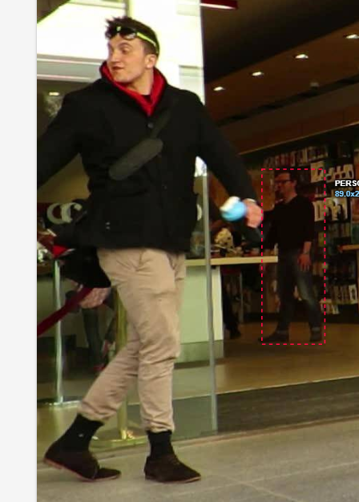
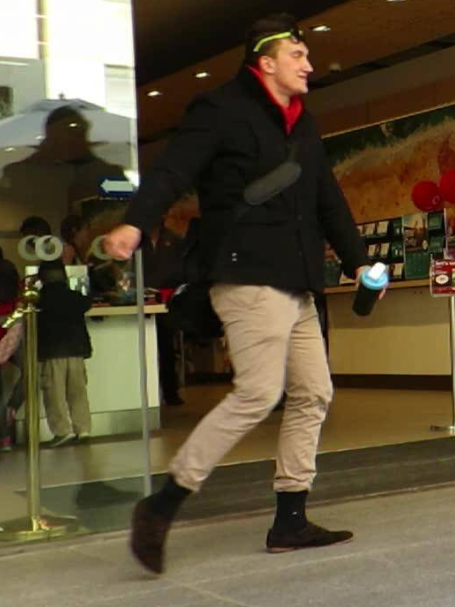
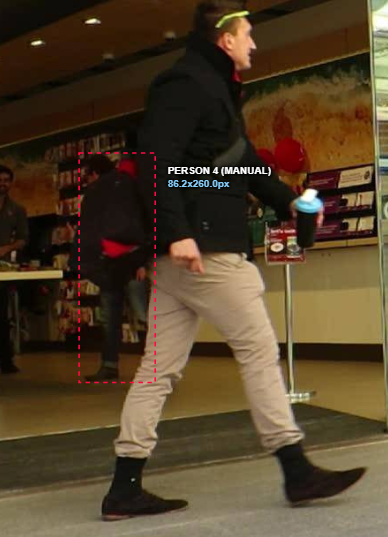
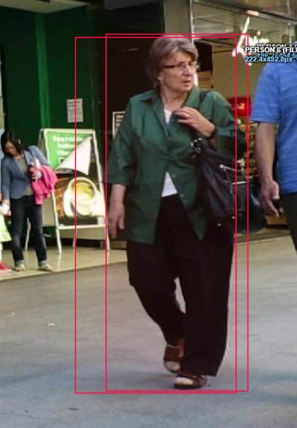

# Báo cáo cá nhân — NguyenVanDai-2A202604070

Đổi tên file theo quy tắc `MSSV_HoTen.md`. Ví dụ: `20241234_NguyenVanAn.md`.

Đoạn video: MOT17-09, 150 frame (frame 1–150), nguồn MOTChallenge, giấy phép CC BY-NC-SA 3.0.

## 0. Thông tin học viên

- Họ tên: Nguyễn Văn Đại
- MSSV: 2A202604070
- Mã đề (A/B/C): A
- Email: vdai20204@gmail.com
- Link repository: https://github.com/Pennywise111124/K5-L2B-Day05-NguyenVanDai-2A202604070-MOTTracking
- Giờ bắt đầu: 17h00
- Giờ kết thúc: 19h30

## 1. Xem trước đoạn video (CP0)

Ghi **trước khi vẽ**, mỗi người một dòng.

| Mã | Frame xuất hiện | Frame cuối thấy được | Rẽ / dừng / đổi tốc độ ở frame | Bị che ở frame | Ghi chú |
|---|---|---|---|---|---|
| P1 | 0 | 149 | đi sang phải với tốc độ khoảng 1,2–3 px/frame, chậm dần và gần như dừng từ khoảng frame 100 | 0–36 (bàn che một phần), 37–49 (mất hẳn, bị người không thuộc 5 người che), 50–55, 98–111 | Người đàn ông trong cửa hàng, đi dần về phía camera |
| P2 | 61 | 149 | đi sang phải khoảng 2,5–3,4 px/frame, chậm lại quanh frame 101–120, đổi chiều nhẹ sau frame 121 | 61–100 (bàn che một phần) | Xuất hiện giữa video, bị bàn che trong 40 frame đầu |
| P3 | 0 | 149 | đi sang trái, tăng tốc dần từ khoảng 2 lên khoảng 8 px/frame | không | Đi về phía camera nên box to dần (cao 338 → 836 px) |
| P4 | 0 | 149 | đi sang trái, tăng tốc từ khoảng 1 lên khoảng 8 px/frame; xuống thấp nhanh ở frame 10–30 | không | Vào khung từ mép phải (frame 0 chỉ thấy bề ngang khoảng 35 px), box to dần (cao 185 → 951 px) |
| P5 | 0 | 144 | đi sang phải đến khoảng frame 30, sau đó gần như đứng yên | 105–107 (che một phần), 108–136 (mất hẳn); từ frame 145 ra khỏi khung | Người ở xa, rất nhỏ (cao khoảng 120 px) |

## 2. Keyframe và thời gian (CP1, CP4)

Số keyframe lấy từ kết quả `src/check_submission.py`.

| Mã | Số keyframe | Keyframe ở frame | Số frame có mặt | Keyframe / 100 frame | Thời gian (phút) | Chỗ khó |
|---|---|---|---|---|---|---|
| P1 | 17 | 0, 12, 21, 30, 36, 50, 51, 56, 57, 64, 73, 86, 98, 112, 117, 147, 149 | 137 | 12.4 | 40 | bị bàn che rồi bị người khác che; người đứng trong cửa hàng |
| P2 | 7 | 61, 64, 79, 95, 101, 119, 149 | 89 | 7.9 | 30 | chưa xuất hiện và bị bàn che suốt 40 frame đầu |
| P3 | 15 | 0, 16, 27, 45, 55, 65, 77, 86, 101, 114, 120, 127, 134, 145, 149 | 150 | 10.0 | 20 | box to dần và tăng tốc khi lại gần camera |
| P4 | 9 | 0, 12, 27, 39, 66, 96, 126, 141, 149 | 150 | 6.0 | 20 | vào khung từ mép phải, box bị cắt ở frame đầu |
| P5 | 16 | 0, 2, 3, 4, 5, 6, 7, 9, 10, 28, 52, 82, 105, 107, 137, 144 | 116 | 13.8 | 40 | người nhỏ, có đoạn mất hẳn 108–136 |
| **Tổng** | 64 | | 642 | 10.0 | 150 | |

Keyframe / 100 frame của cả bài = 64 ÷ 642 × 100 = 10,0

Bạn đặt keyframe nhiều nhất ở người nào? Vì sao (người đó rẽ, dừng, lại gần camera hay bị che)?

- P1 có nhiều keyframe nhất (17). Lý do chính là P1 bị che hai lần và đổi cờ nhiều lần (`occluded` ở frame 0–36, `outside` ở 37–49, `occluded` lại ở 50–55 và 98–111), mà mỗi lần đổi cờ phải có một keyframe (36, 50, 51, 56, 57, 98, 112). Ngoài ra P1 còn chậm dần rồi dừng ở khoảng frame 100.

## 3. Đoạn bị che (CP2)

Người bị che: `P1`

| Mốc | Frame |
|---|---:|
| Bắt đầu bị che một phần (bật `occluded`) | 0 |
| Mất hẳn (bật `outside`) | 37 |
| Hiện lại (tắt `outside`) | 50 |
| Thấy rõ trở lại (tắt `occluded`) | 56 |

- Thời gian khuất hẳn: 13 frame = 13/30 ~ 0.43 giây.
- Quyết định: giữ cùng ID .
- Lý do (trả lời 3 câu: khuất bao lâu so với 60 frame, ngoại hình có khớp, chỗ hiện lại có đúng hướng và tốc độ):

- Khuất hẳn chỉ 13 frame, xa dưới ngưỡng 60 frame (2 giây) của lớp. Ban đầu P1 bị bàn che một phần (frame 0–36), sau đó một người không thuộc 5 người cần gán ID đi qua che hẳn (frame 37–49); khi người đó đi qua, P1 vẫn ở vị trí cũ trong cửa hàng và ngoại hình khớp với trước đoạn che. Vị trí hiện lại gần chỗ biến mất và cùng hướng đi sang phải, tốc độ trước che khoảng 2,4 px/frame và sau che khoảng 3,1 px/frame, kích thước box tương đương (cao 220 px ở frame 36 và 260 px ở frame 50). Vì vậy giữ nguyên track thay vì tạo ID mới.

Ảnh chụp màn hình:





## 4. Tự review ID (CP3)

Lượt 1 theo người (đi ngược từ frame 149 về 0 trên CVAT), lượt 2 theo cảnh (nhảy 10 frame). Ít nhất 3 dòng; không có lỗi thì ghi một dòng "đã kiểm hai lượt, không lỗi".

Loại lỗi dùng đúng một trong 7 mã: `id_switch`, `fragmentation`, `lost`, `merge`, `false_track`, `drift`, `flag`.

| Frame | Mã người | Loại lỗi | Mô tả một câu | Phát hiện ở lượt | Đã sửa? |
|---:|---|---|---|---|---|
| 0 | P1 | `false_track` | Track nháp của script gán nhầm sang đứa trẻ, trong khi người đàn ông trong cửa hàng (P1) không có box | lượt 1 | Có, P1 được tạo/sửa trực tiếp trong CVAT |
| 84 | P2 | `flag` | Bị bàn che nhưng chưa bật cờ `occluded` | lượt 1 | Có, P2 đã được sửa trực tiếp trong CVAT |
| 126 | P4 | `drift` | Box của người lớn tuổi lệch, không ôm sát toàn thân | lượt 1 | Có, P4 được sửa trực tiếp trong CVAT |

Tổng hợp số lỗi theo loại:

| `id_switch` | `fragmentation` | `lost` | `merge` | `false_track` | `drift` | `flag` |
|---:|---:|---:|---:|---:|---:|---:|
| 0 | 0 | 0 | 0 | 1 | 1 | 1 |

Lỗi nào chỉ lượt 2 (theo cảnh) mới thấy, lượt 1 (theo người) không thấy? Vì sao?

- Không có lỗi nào chỉ lượt 2 (theo cảnh) mới thấy. Cả 3 lỗi (`false_track` ở P1, `flag` ở P2, `drift` ở P4) đều được phát hiện và sửa ở lượt 1 (theo từng người); lượt 2 (nhảy 10 frame, nhìn cả 5 box cùng lúc) chỉ dùng để kiểm tra lại và không phát hiện thêm lỗi nào.

## 5. File xuất và kết quả tự kiểm (CP4)

| Kiểm tra | Kết quả |
|---|---|
| Tên file MOT 1.1 | src/exports/NguyenVanDai_mot.zip |
| Tên file CVAT for video 1.1 | src/exports/NguyenVanDai_cvat_video.zip |
| Số track ID khác nhau trong `gt/gt.txt` (phải là 5) | 5 (ID 1–5), tổng 642 box |
| Frame `outside` không có dòng trong `gt.txt` (đúng / sai) | Đúng (đối chiếu từng frame giữa gt.txt và annotations.xml, không có sai khác) |
| Job đã completed trên CVAT máy cá nhân | Đã chuyển sang completed nhưng làm trên CVAT online app.cvat.ai |

Dán phần tóm tắt in ra từ `src/check_submission.py`:

```
Số frame in theo CVAT (bắt đầu từ 0). Trong gt.txt, frame_id = frame CVAT + 1.

=== File MOT 1.1: NguyenVanDai_mot.zip ===
  Số track ID: 5   |   Tổng số box: 642
  [OK]        Đúng 5 track ID.

  Track | Frame có mặt | Số frame | Đoạn vắng (outside)
      1 |   0–149      |      150 | -
      2 |   0–144      |      116 | 108–136
      3 |   0–149      |      137 | 37–49
      4 |   0–149      |      150 | -
      5 |  61–149      |       89 | -


=== File CVAT for video 1.1: NguyenVanDai_cvat_video.zip ===

  Track | Nhãn   | Frame thấy | Keyframe | KF/100 frame | Frame occluded | Lần bật outside
      0 | person |        150 |       15 |         10.0 |              0 |               0
      1 | person |         89 |        7 |          7.9 |             40 |               0
      2 | person |        116 |       16 |         13.8 |              3 |               2
      3 | person |        137 |       17 |         12.4 |             57 |               1
      4 | person |        150 |        9 |          6.0 |              0 |               0

  Tổng: 64 keyframe / 642 frame có mặt = 10.0 keyframe / 100 frame
  [OK]        Đọc được 5 track từ annotations.xml.

=== Tóm tắt ===
  Lỗi: 0   |   Cảnh báo: 0
  Đạt. Dán phần tóm tắt này vào báo cáo mục 5.
```
- Ghi chú: track MOT 1–5 tương ứng P3, P5, P1, P4, P2; track CVAT 0–4 tương ứng P3, P2, P5, P1, P4.

## 6. Ba câu kết

1. Nếu được gán lại, bạn sẽ đặt keyframe khác ở đâu? Vì sao?

- Mình sẽ đặt dày hơn ở P4 và P5 trong các khoảng nội suy dài 30 frame (P4: 66→96→126, P5: 52→82 và 107→137). P4 đi về phía camera và tăng tốc từ khoảng 1 lên khoảng 8 px/frame, nên nội suy tuyến tính dễ lệch ở giữa các keyframe cách xa nhau. Mình cũng sẽ đặt keyframe ngay tại các frame đổi trạng thái che của P1 (36, 50, 56) từ đầu, thay vì để script làm thưa rồi mới kiểm tra lại.

2. Có chỗ nào bạn không chắc "cùng ID hay ID mới"? Bạn đã quyết định và ghi chú thế nào?

- Chỗ đáng cân nhắc nhất là đoạn P1 bị che hẳn 13 frame (37–49) và đoạn P5 mất hẳn 29 frame (108–136). Cả hai đều dưới ngưỡng 60 frame, vị trí hiện lại gần chỗ biến mất và đi cùng hướng, nên mình giữ cùng ID. Với P1, lý do được ghi chi tiết ở mục 3; với P5, mình ghi đoạn mất hẳn ở mục 2 (cột "Chỗ khó") và giữ nguyên một track.

3. Một lỗi ID trong job của bạn (nếu không còn sót, chọn lỗi đã sửa) có thể làm xe tự lái dự đoán sai chuyển động của người đó như thế nào? Lỗi đó ảnh hưởng MOTA hay IDF1 nhiều hơn?

- Lỗi mình đã gặp là track của người đàn ông trong cửa hàng (P1) bị gán nhầm sang đứa trẻ ở frame 0. Nếu hệ thống tự lái dùng ID đó, nó sẽ coi chuyển động của đứa trẻ là của người đàn ông: dự đoán sai tốc độ, hướng đi và kích thước, và người thật sự không còn được theo dõi. Lỗi này ảnh hưởng IDF1 nhiều hơn MOTA: MOTA chỉ đếm đây là một số ít sự kiện (bỏ sót, dương tính giả hoặc đổi ID), còn IDF1 đo mỗi người được giữ cùng một ID trong bao nhiêu phần thời gian, nên một track gắn sai người kéo tụt cả đoạn dài.

## Bonus

### B1 — Hai người đi sát

...

### B2 — So cách đặt keyframe

Người chọn: P3 (nhìn thấy đủ 150 frame, không có đoạn che). Track phụ chỉ có keyframe đều ở frame 0, 30, 60, 90, 120, 149, không chỉnh thêm, không bật `occluded` / `outside`. File xuất riêng: `src/exports/NguyenVanDai_bonus_b2.zip`; track phụ đã xoá khỏi job trước khi nộp.

| Cách đặt | Số keyframe | Frame trôi nhất | Ghi chú |
|---|---:|---:|---|
| Đều mỗi 30 frame | 6 | 77 | IoU thấp nhất 0,74; IoU trung bình 0,89; không có frame nào IoU < 0,7 |
| Theo chỗ đổi hướng | 15 | (track chính) | track chính, dùng làm chuẩn so sánh |

Frame trôi nhất là 77, nằm giữa hai keyframe đều 60 và 90; box phụ lệch tâm khoảng 30 px so với người, còn chiều cao box gần như đúng (493 px so với 494 px). Nội suy tuyến tính giữa hai keyframe giả định người đi với vận tốc không đổi, khoảng 3,8 px/frame sang trái trong suốt 30 frame. Thực tế P3 chậm lại còn khoảng 1,8 px/frame trong frame 65–77 rồi tăng tốc lên khoảng 5,8 px/frame sau frame 77, nên đến giữa đoạn box phụ không còn khớp. Đúng chỗ đó (frame 77) track chính có một keyframe để bắt đổi tốc độ. Kết luận: keyframe đều tiết kiệm (6 so với 15) và vẫn cho IoU trung bình 0,89 khi người đi gần như thẳng, nhưng sai nhiều ở chỗ đổi tốc độ, nên keyframe đặt theo chỗ đổi hướng và đổi tốc độ cho kết quả đáng tin hơn.



### B3 — So với tracker có sẵn

| Frame | Mã người | Tracker làm gì | Nhãn của bạn | Giải thích (đoán rồi sửa / ghép IoU / box score thấp / ngoại hình) |
|---:|---|---|---|---|
| | | | | |
| | | | | |

## 7. Tài liệu tham khảo và công cụ AI đã dùng

- Công cụ gán nhãn: CVAT online (app.cvat.ai), track mode với keyframe và nội suy tuyến tính.
- Claude (Anthropic): được dùng để hướng dẫn từng bước các checkpoint.
